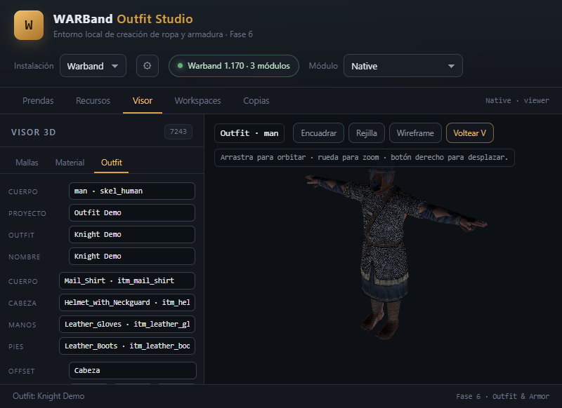
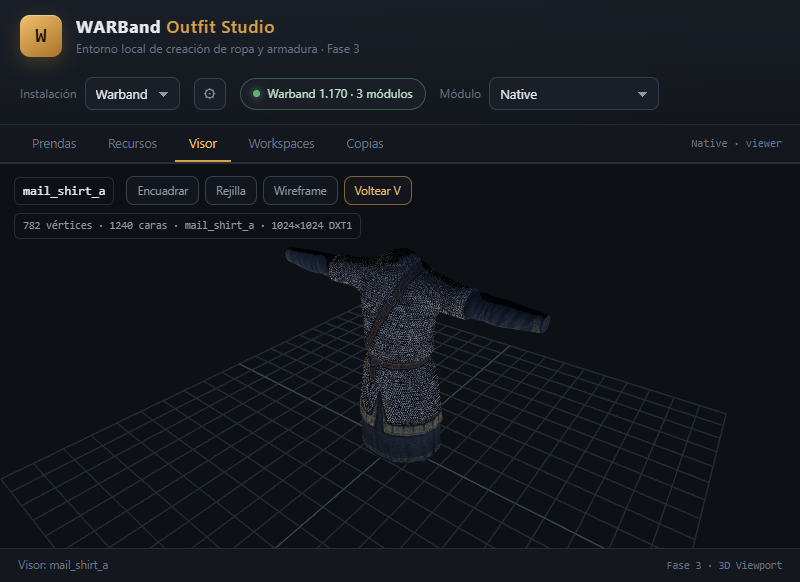
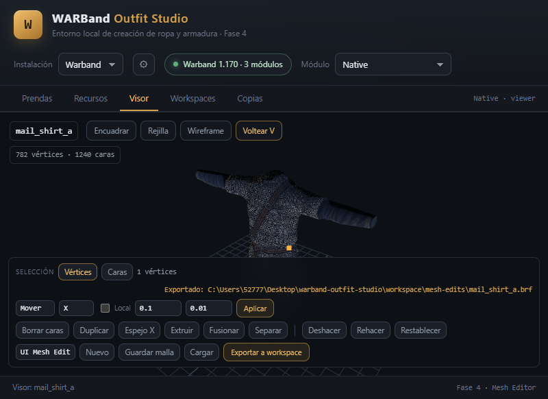
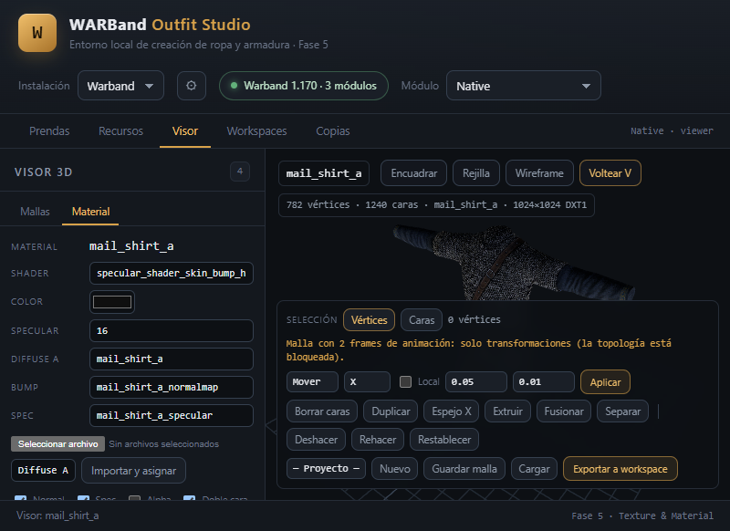
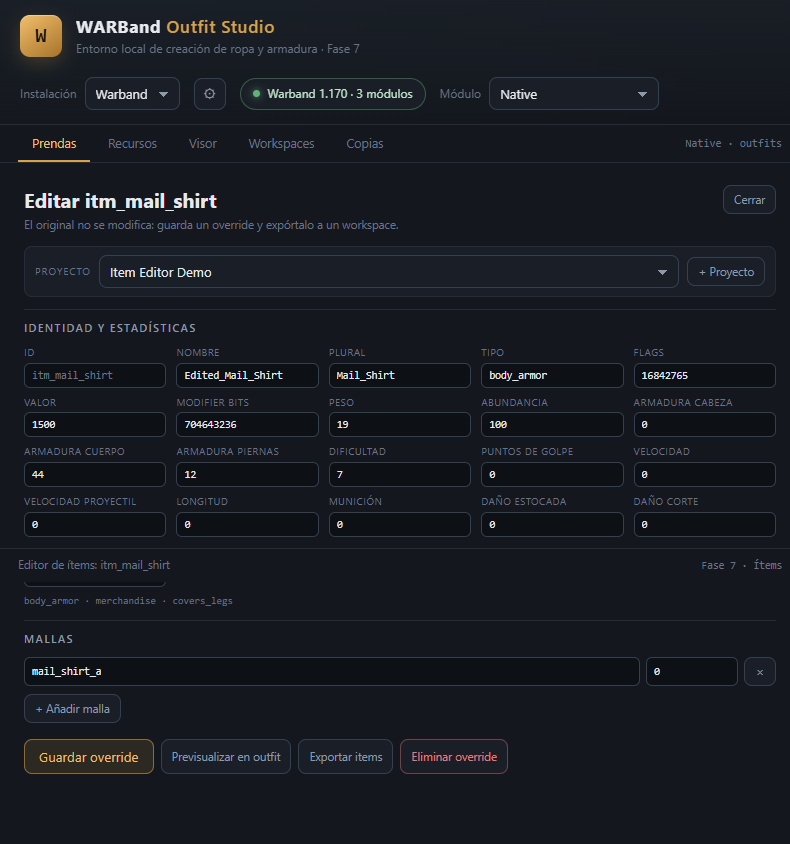

# WARBand Outfit Studio

**Entorno local, offline y seguro para crear ropa, armaduras y outfits para Mount & Blade: Warband.**

WARBand Outfit Studio lee una instalación real del juego, resuelve la cadena completa
`Item → Mesh → Material → Texture → .dds` y ofrece herramientas para inspeccionar,
validar, editar y construir contenido sin modificar nunca la instalación original.

> **Primera versión pública — `0.11.0`**  
> Roadmap 0–10 completado: visor 3D, edición de mallas, materiales, outfits, ítems,
> builds, recuperación y empaquetado portátil.



---

## Características

### Exploración de assets
- Catálogo de prendas y armaduras de Native, Viking Conquest y Napoleonic Wars.
- Resolución de ítems, familias de mallas, LODs, materiales, texturas DDS y shaders.
- Validación de cadenas de recursos con códigos estables.
- Índice persistente de BRFs para arranques rápidos.

### Visor 3D
- Visor WebGL con Three.js embebido; sin CDN ni conexión a Internet.
- Selección de mallas, encuadre, rejilla, wireframe y corrección UV.
- Decodificación DDS en el navegador.
- Cuerpos reales `man` / `woman` desde `skins.txt`.

### Edición
- **Mallas:** selección de vértices/caras, transformaciones, topología, undo/redo y overrides.
- **Materiales:** color 0–255, specular, texturas diffuse/bump/spec, importación DDS y exportación.
- **Outfits:** composición por ranuras, offsets, clipping básico, presets y guardado en proyecto.
- **Ítems:** registro completo, flags/capabilities, mallas, estadísticas, creación y overrides.

### Builds y recuperación
- Build validado de overrides de mallas, materiales, texturas e ítems.
- Modo overlay o copia completa del módulo.
- `build.json` + `build.log` con rutas y SHA-256.
- Diff fuente/build, rollback al proyecto y retención keep-N.
- Backups de proyectos y workspaces con restauración verificada.
- Integración opcional de `module.ini` para recursos BRF añadidos.

### Seguridad
- La instalación de Warband es **de solo lectura**.
- Escrituras limitadas a `projects/`, `workspace/`, `cache/` y `backups/`.
- Sin nube, sin cuentas, sin telemetría y sin dependencias npm de runtime.
- El despliegue de un build es una copia manual deliberada, nunca automática.

---

## Inicio rápido

### Opción A — Ejecutable incluido

Haz doble clic en:

```text
WARBand Outfit Studio.exe
```

El lanzador:

1. inicia el servidor local;
2. abre el navegador;
3. mantiene el servidor dentro de un Windows Job Object;
4. **al cerrar la ventana del lanzador detiene el servidor y sus procesos hijos**.

`Warband Outfit Studio.cmd` queda como lanzador de respaldo.

### Opción B — Desde el código

Requisitos: **Windows** y **Node.js 22+**.

```bat
node backend\server\index.js --open
```

o:

```bat
npm start
```

No hace falta ejecutar `npm install`: el proyecto tiene **cero dependencias npm de runtime**.

### Opción C — Release portátil

```bat
npm run release
```

Genera `dist/warband-outfit-studio-0.11.0/` con:

- ejecutable y launcher `.cmd`;
- runtime Node embebido (por defecto);
- engine, backend, frontend y documentación;
- carpetas de datos vacías.

---

## Primera ejecución

1. Abre el programa.
2. Si no hay una instalación registrada, se abre automáticamente el asistente.
3. Selecciona la carpeta que contiene `mb_warband.exe` y `Modules`.
4. Elige el módulo (`Native`, `Viking Conquest`, `Napoleonic Wars`).
5. Abre **Sistema** para comprobar Node, instalación, módulos y carpetas de escritura.

---

## Flujo de trabajo

```text
Prendas
  └─ inspeccionar ítem / editar registro / guardar override
Visor
  ├─ Mallas: editar geometría y guardar override
  ├─ Material: editar material y texturas
  └─ Outfit: componer y previsualizar el conjunto
Build
  ├─ validar overrides
  ├─ construir overlay o copia completa
  ├─ ver diff
  └─ rollback al proyecto
Copias
  └─ restaurar / limpiar backups
Sistema
  └─ health checks, entorno, recuperación y logs
```

---

## Capturas

| Visor 3D | Edición de mallas |
|---|---|
|  |  |

| Materiales | Ítems |
|---|---|
|  |  |

| Outfits |
|---|
|  |

---

## Estructura

```text
engine/       Warband Engine: instalación, módulos, BRF, ítems, proyectos, build
backend/      Servidor HTTP local y API JSON
frontend/     UI vanilla HTML/CSS/JS + Three.js embebido
docs/         Arquitectura, formatos, decisiones y guías
tests/        Suites node:test unitarias y de integración
tools/        Índice, exportadores, release y launcher
projects/     Proyectos de usuario
workspace/    Builds y exports
backups/      Copias automáticas
cache/        Índice y logs derivados
```

---

## Tests

```bat
npm test
npm run test:unit
npm run test:integration
```

**115/115 tests pasando.**

Cobertura destacada:

- parseo y round-trip de BRF, ítems, DDS y materiales;
- 219/219 archivos `CommonRes` con round-trip byte-idéntico;
- edición real de mallas, materiales e ítems;
- outfits y cuerpos reales;
- builds, diff, rollback, retención y backups;
- release portátil con servidor funcional;
- API HTTP y seguridad de rutas.

Las pruebas de integración leen la instalación real y **nunca escriben en ella**.

---

## Documentación

- [Plan de proyecto](PROJECT_PLAN.md)
- [Registro de progreso](PROGRESS.md)
- [Arquitectura](docs/architecture/ARCHITECTURE.md)
- [Modelo de datos](docs/architecture/DATA-MODEL.md)
- [Visor 3D](docs/architecture/VIEWPORT.md)
- [Editor de mallas](docs/architecture/MESH-EDITOR.md)
- [Materiales](docs/architecture/MATERIALS.md)
- [Outfits](docs/architecture/OUTFITS.md)
- [Ítems](docs/architecture/ITEMS.md)
- [Builder](docs/architecture/BUILDER.md)
- [Guía de usuario](docs/guides/USER-GUIDE.md)
- [Guía de release](docs/guides/RELEASE.md)
- [Decisiones técnicas](docs/development/DECISIONS.md)

---

## Estado del proyecto

| Fase | Estado |
|---|---|
| 0 — Fundación | ✅ |
| 1 — Resource Engine | ✅ |
| 2 — Game & Module Manager | ✅ |
| 3 — Visor 3D | ✅ |
| 4 — Editor de mallas | ✅ |
| 5 — Materiales y texturas | ✅ |
| 6 — Outfits | ✅ |
| 7 — Editor de ítems | ✅ |
| 8 — Builder | ✅ |
| 9 — Retención y recuperación | ✅ |
| 10 — Release y producción | ✅ |

Esta es la primera versión pública estable. El roadmap acordado está completo;
las siguientes líneas de trabajo son estudios especializados, despliegue opcional
y mejoras post-1.0.

---

## Licencia

Consulta [LICENSE](LICENSE).

Mount & Blade: Warband y sus assets pertenecen a TaleWorlds Entertainment.
Este proyecto no está afiliado a TaleWorlds.
