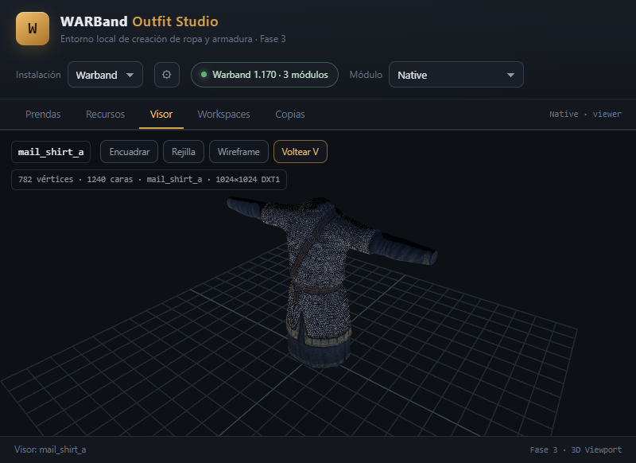

# 3D viewport (Phase 3)

The **Visor** tab renders a Warband mesh locally with no cloud, no CDN and no
extra runtime dependency beyond the vendored Three.js build.

## 1. Delivery of Three.js

| Item | Value |
|---|---|
| Library | Three.js **0.169.0** (MIT) |
| Location | `frontend/vendor/three/three.module.js` + `LICENSE` |
| Import | `import * as THREE from '../vendor/three/three.module.js'` |
| CDN / network | **none** at runtime |

Orbit controls are implemented in-house (`frontend/js/viewer-controls.js`)
instead of vendoring the `OrbitControls` addon. This avoids an import map and
keeps the CSP at `script-src 'self'`.

## 2. Data flow

```
Visor tab
  └─ GET /api/resources?type=mesh            (list/search)
  └─ GET /api/resources/mesh/:name           (material + diffuse texture refs)
  └─ GET /api/meshes/:name/geometry          (base64 typed arrays)
        positions / normals / uvs / indices
  └─ GET /api/textures/:name/raw             (raw DDS bytes)
        └─ frontend/js/dds.js decodes DXT1/3/5
        └─ THREE.DataTexture
```

### Geometry adaptation (VERIFIED)

BRF faces index the **vertex list**, and each vertex stores an index into the
position array (`vertex.index`). The engine expands positions/normals/UVs per
vertex before sending them, so the viewport can use the face array directly as
`BufferGeometry.index`.

- `positions`: `Float32Array`, `count = vertexCount`
- `normals`: `Float32Array`
- `uvs`: `Float32Array`
- `indices`: `Uint32Array` (`faceCount * 3`)
- `uvFlip: 'v'` marker

## 3. UV convention

BRF UVs are stored raw. OpenBRF flips V on load for its renderer, so the
viewport defaults to **`v' = 1 - v`** and exposes a **Voltear V** toggle.

Classification: **LIKELY** — the flip matches OpenBRF's documented behaviour, but
the exact engine sampling was not traced. The toggle makes either convention
usable without re-parsing.

The `DataTexture` is created with `flipY = false` (DDS rows are top-down).

## 4. DDS decoder

`frontend/js/dds.js` decodes the first mip level to RGBA:

| Format | Support |
|---|---|
| DXT1 / BC1 | 4-colour and 3-colour + transparent modes |
| DXT3 / BC2 | explicit 4-bit alpha + 4-colour |
| DXT5 / BC3 | interpolated 8-bit alpha + 4-colour |
| DX10 header | BC1/BC2/BC3 DXGI formats 71/72/74/75/77/78 |
| Uncompressed 32-bit | BGRA fallback |

Not decoded: mipmaps, DXT2/DXT4 (premultiplied variants), BC4–BC7, cube maps.

## 5. Scene

- `WebGLRenderer` (antialias, sRGB output, pixel ratio ≤ 2).
- `PerspectiveCamera(45°)` + custom orbit/pan/zoom controls.
- Lights: hemisphere + key directional + blue fill.
- Grid scaled to the mesh bounding box, placed at `bbox.min.y`.
- `MeshStandardMaterial` with the diffuse map (or the material colour when no
  texture), `DoubleSide`, roughness 0.78, metalness 0.05.
- Wireframe toggle, framing button, resize observer, render loop paused when the
  tab is not visible.

## 6. Measured results

| Metric | Value |
|---|---|
| Mesh | `mail_shirt_a` (782 verts / 1,240 faces) |
| Texture | 1024×1024 DXT1 |
| FPS (browser, 800×384) | **60** (vsync) |
| Render | correct silhouette, chainmail diffuse visible, no console errors |

The viewport was verified with a real screenshot during Phase 3:



## 7. Limits and next steps

- One mesh at a time; no skeleton pose or skinning yet (bind pose only).
- Diffuse map only; normal/specular preview was added in the Phase 5 material panel.
- No mipmaps, shadows or texture streaming.
- No mesh editing (Phase 4).
- The asset list shows LOD/piece meshes as separate rows.
- Geometry is fetched per selection; an LRU cache is deferred until needed.

## 8. API added in Phase 3

| Method | Path | Purpose |
|---|---|---|
| GET | `/api/meshes/:name/geometry?module=` | render-ready base64 typed arrays + bbox/counts |
| GET | `/api/textures/:name/raw?module=` | raw DDS bytes (binary response) |
